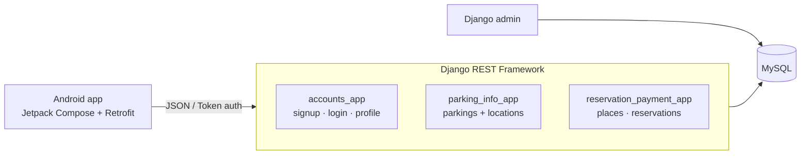
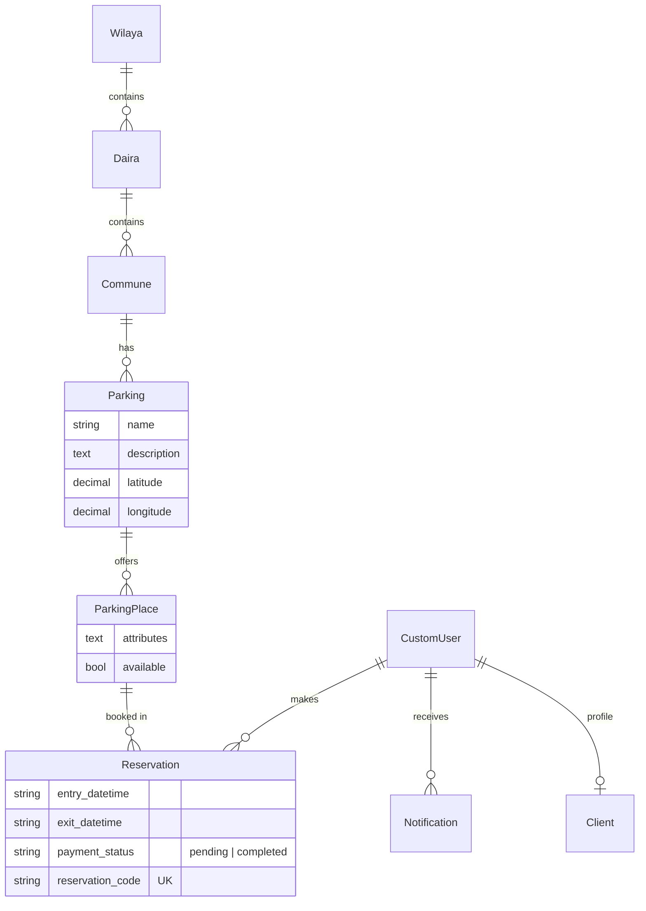

# Parking Reservation · Backend API

[](https://github.com/MehdiBedja/Reservation-app-backend/actions/workflows/tests.yml)


A Django REST Framework API for a parking reservation app. It manages users, parkings organized by Algerian administrative divisions (wilaya → daïra → commune), parking places and their availability, and reservations with unique codes and payment status. The [Android client](https://github.com/MehdiBedja/Reservation-app-frontend) consumes it.

## Architecture



### Data model



## API

| Method | Endpoint | Description |
| --- | --- | --- |
| POST | `/user/signup` | Create an account `{user_type: "client", user: {...}}` |
| POST | `/user/login` | Returns `{token, user}` |
| GET | `/user/get_user_info` | Current user (token) |
| POST | `/user/change_password` | Change password (token) |
| POST | `/user/logout` | Revoke token |
| GET | `/user/getUser/<id>/` | Public profile |
| GET | `/parkings/getParkings/` | All parkings with commune name |
| GET | `/parkings/getParkingsId/` | Parkings with ids and coordinates |
| GET | `/parkings/getParking/<id>/` | One parking |
| GET | `/reservations/getAllParkingPlaces/<parking_id>/` | Available places in a parking |
| POST | `/reservations/addReservation/` | Book a place |
| GET | `/reservations/myReservations/<user_id>/` | A user's reservations |
| GET | `/reservations/getReservation/<id>/` | One reservation |

`test.rest` contains ready-to-run requests for the VS Code REST Client.

## Run locally

```bash
git clone https://github.com/MehdiBedja/Reservation-app-backend.git
cd Reservation-app-backend/Reservation_app_backend
python -m venv venv && source venv/bin/activate   # Windows: venv\Scripts\activate
pip install -r requirements.txt
```

Create `Reservation_app_backend/.env`:

```env
DB_ENGINE=django.db.backends.mysql
DB_NAME=parking
DB_USER=root
DB_PASSWORD=...
DB_HOST=localhost
DB_PORT=3306
NGROK_ADDRESS=your-subdomain.ngrok-free.app   # optional, to reach it from a phone
```

Then run the migrations and start the server:

```bash
python manage.py migrate
python manage.py createsuperuser
python manage.py runserver 0.0.0.0:8000
```

## Tests

There are 21 API tests covering auth, parkings and reservations. They run on in-memory SQLite, so no database server is needed:

```bash
python manage.py test --settings=Reservation_app_backend.settings_test
```

GitHub Actions runs them on every push.

## Author

**Mahdi Bedja** · [Portfolio](https://mehdibedja.github.io) · [LinkedIn](https://www.linkedin.com/in/mahdi-bedja-0b94031b3/)
